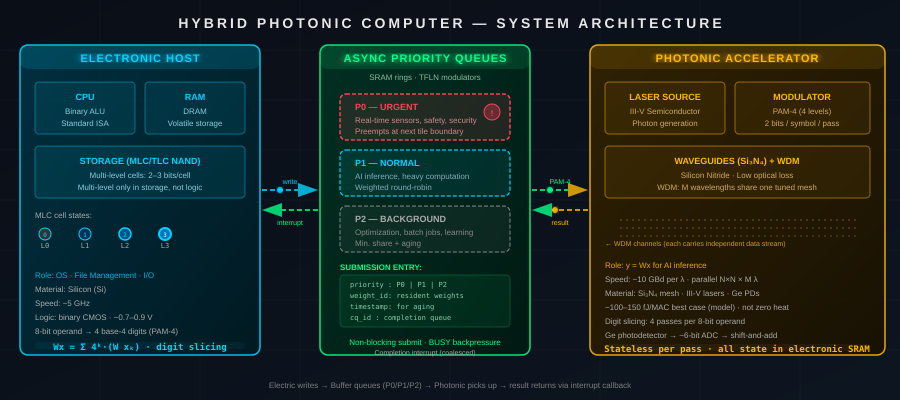
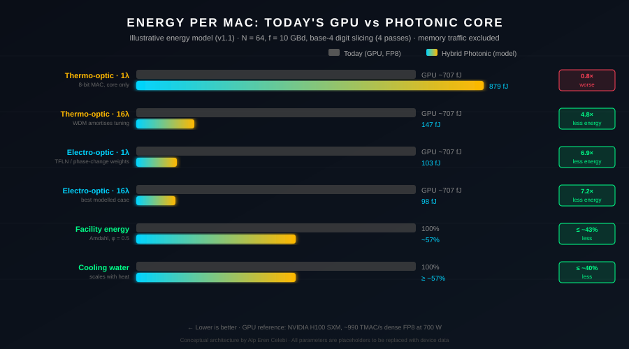

# Hybrid Photonic Computer Architecture

[](https://doi.org/10.17605/OSF.IO/4U6QB)
[](zenodo-submission.html)
[](hybrid-photonic-computer-v1.1.pdf)
[](LICENSE)

> A conceptual architecture in which a standard **electronic host** offloads matrix math to a **photonic accelerator** through **asynchronous priority queues**. **Base-4 digit slicing** lets every optical pass use proven PAM-4 signalling. Under stated assumptions, the photonic core reaches roughly **5–7× lower energy per operation** than a current GPU in its best configurations.



> **v1.1 (October 19, 2026) is a revision.** Several claims in v1.0 (March 26, 2026) were physically wrong or unsupported: THz processing, "photons produce no heat", 90% water savings, a LiNbO₃ crystal storing the queue, and radiation immunity in space. They are corrected or withdrawn. The full list is in Appendix A of the paper ([HTML](zenodo-submission.html) · [PDF](hybrid-photonic-computer-v1.1.pdf)).

---

## The Core Idea

| Part | Technology | Role |
|------|-----------|------|
| Electronic host | Binary CMOS (Si), DRAM, MLC/TLC NAND | OS, applications, storage, control flow, non-linear ops |
| Control die | SRAM queues, scheduler, DAC/ADC, partial-sum SRAM | Async priority queues, digit slicing, shift-and-add |
| Photonic core | Si₃N₄ weight mesh, thin-film LiNbO₃ modulators, III-V lasers, Ge detectors, WDM | Linear algebra `y = Wx` for AI inference |

All state lives in electronics. The photonic core holds no state between passes, so it never needs optical memory.

---

## Base-4 Digit Slicing: What 4⁴ = 256 Actually Buys

`4⁴ = 256` alone is **not** an advantage. Every power-of-two base maps exactly onto 256 values (`2⁸ = 16² = 256`), and an ordinary byte already does. Base 4 becomes useful when it sets how many light levels each pass must resolve:

```
x  = Σ 4ᵏ · xₖ          xₖ ∈ {0,1,2,3}      (8-bit input = 4 base-4 digits)
Wx = Σ 4ᵏ · (W xₖ)                          (optics is linear)
```

Each pass needs only **PAM-4** (4 light levels, already mass-produced for optical Ethernet) instead of 256 levels. The control die recombines the four partial results by shift-and-add.

| Bits / symbol | Levels | Required SNR (ideal, 6.02·b + 1.76 dB) | Passes for 8-bit |
|---|---|---|---|
| 1 | OOK | 7.8 dB | 8 |
| **2** | **PAM-4 (chosen)** | **13.8 dB** | **4** |
| 4 | PAM-16 | 25.8 dB | 2 |
| 8 | PAM-256 (v1.0) | 49.9 dB, not practical | 1 |

**Open problem:** exactly accumulating 64 products needs ~11.5 output bits, but fast, low-energy ADCs give about 6.

---

## Why the Host Stays Binary

v1.0 proposed base-4 logic at 0 / 1.1 / 2.2 / 3.3 V. At a fixed supply, the four-level gap is `V_DD / 3`, so the noise margin is worse than binary, not better. A 3.3 V supply also costs about `(3.3 / 0.75)² ≈ 19×` in dynamic power compared with a modern ~0.75 V. Multi-level encoding is therefore used only where it already works: MLC/TLC NAND storage and PAM-4 optical links. A binary host also means **existing software runs unchanged**. Only a driver, a runtime and a compiler back-end are new.

---

## Async Priority Queues

```
  HOST ──submit──►  ┌──────────────────────────────┐ ──PAM-4──►  PHOTONIC
  (never blocks;    │  CONTROL DIE (SRAM rings)    │              CORE
   BUSY if full)    │  P0 urgent  → strict, preempt│ ◄──Ge PD───  (stateless
  ◄──completion IRQ─│  P1 normal  → weighted RR    │    + ADC      per pass)
                    │  P2 backgr. → min share+aging│
                    └──────────────────────────────┘
```

- **Queues live in SRAM.** The Pockels effect changes LiNbO₃'s refractive index only while voltage is applied, so LiNbO₃ cannot store data. It is used as the modulator instead.
- **Tile-granular preemption:** a P0 job takes over at the next tile boundary. Partial sums are in SRAM, so no optical memory is needed. Latency-critical weights stay resident on a dedicated mesh or wavelength group.
- **Non-blocking, stated precisely:** submission returns `BUSY` when the queue is full (backpressure). Asynchrony overlaps independent requests, but it cannot remove data dependencies such as token-by-token decoding.
- Arbitration follows the NVMe-style *urgent + weighted round-robin* scheme.

```
submission_entry {
  priority   : P0 | P1 | P2
  weight_id  : handle to resident weights
  input_ptr  : operand tile address
  output_ptr : result tile address
  shape      : (rows, cols, batch)
  digits     : passes per operand (4 for 8-bit, base-4)
  timestamp  : for aging
  cq_id      : completion queue
}
```

---

## Energy Model



```
E_MAC = D · [ (E_DAC + E_ADC) / N  +  P_L / (f·N²)  +  P_T / (f·M·N²) ]
```

Assumptions (placeholders to be replaced with device data): N = 64, f = 10 GBd, D = 4 passes, E_DAC = 0.1 pJ, E_ADC = 1 pJ, P_L = 0.3 W per wavelength, and P_T = 8 W (thermo-optic) or 0.05 W (electro-optic / non-volatile).

| Configuration | fJ per 8-bit MAC | vs GPU (~707 fJ) | Throughput per core |
|---|---|---|---|
| Thermo-optic, 1 λ | 879 | **0.8× (worse)** | 10 TMAC/s |
| Thermo-optic, 16 λ | 147 | 4.8× | 164 TMAC/s |
| Electro-optic / NV, 1 λ | 103 | 6.9× | 10 TMAC/s |
| Electro-optic / NV, 16 λ | 98 | 7.2× | 164 TMAC/s |

GPU reference: NVIDIA H100 SXM, ~990 TMAC/s dense FP8 at 700 W. The photonic figures exclude memory traffic, so they **favour** photonics.

**Takeaways**

1. Weight-element technology decides whether there is any advantage at all.
2. The best case is about 5–7×, not 100×.
3. Throughput per core is modest, so many cores are needed.

**Facility level (Amdahl):** if 50% of facility energy is offloadable matrix math and it gets 7× cheaper, total energy drops by at most ~43%. Cooling water follows a similar bound.

---

## Advantages

1. **~5–7× lower energy per MAC** in the best modelled configurations
2. **Proven optical format:** PAM-4 instead of an impractical 256-level signal
3. **Preemption without optical memory:** all state stays in SRAM
4. **Independent scaling:** add accelerator cores without touching host software
5. **Existing software runs as-is:** the host is ordinary binary CMOS
6. **Fault isolation:** if the accelerator fails, the host keeps running

## Disadvantages and Open Problems

1. **Output precision:** ~6-bit ADCs against the ~11.5 bits needed for exact accumulation
2. **Weight elements:** thermo-optic is power-hungry and slow, electro-optic is large, phase-change wears out
3. **Memory wall unchanged:** weights and activations still come from host memory
4. **Integration and packaging:** photonic core, control die and lasers must be co-packaged
5. **Lasers:** ~10–30% wall-plug efficiency, temperature-sensitive
6. **Inference only:** precision is too low for training
7. **No validation yet:** the model has not been checked against device simulation or measurements

## Space (Speculative)

The waveguides themselves do not suffer charge-deposition bit flips, and cheaper matrix math helps power-limited probes. Photodetectors, lasers, ADCs, the control die and the host still need radiation hardening, and optical materials darken under radiation. **v1.0's immunity and 5,000× claims are withdrawn.**

---

## Related Work

Photonic matrix multiplication with MZI meshes (Shen et al., 2017), phase-change photonic tensor cores (Feldmann et al., 2021), photonic MAC energy analysis (Nahmias et al., 2020), and an electronic–photonic AI processor running ResNet/BERT (Ahmed et al., *Nature* 2025). No novelty is claimed for individual components. The contribution is the combination and the accompanying analysis. Full references are in the [paper](zenodo-submission.html).

---

## Project Structure

```
hybrid-photonic-computer/
├── index.html                      # Interactive visualization (TR/EN, self-contained)
├── zenodo-submission.html          # Technical concept paper (v1.1, HTML)
├── hybrid-photonic-computer-v1.1.pdf  # Same paper as PDF (A4, 15 pages)
├── README.md                       # This file
├── LICENSE                         # MIT
└── assets/
    ├── architecture-diagram.svg    # System architecture diagram
    ├── ai-impact-comparison.svg    # Energy-per-MAC model chart
    └── computer-3d-concept.svg     # Isometric 3D concept render
```

## Run Locally

No build step, no dependencies, no server required.

```bash
git clone https://github.com/alpcelebi/hybrid-photonic-computer.git
cd hybrid-photonic-computer

# Windows
start index.html
# macOS
open index.html
# Linux
xdg-open index.html
```

All animations use the Canvas 2D API, with no WebGL and no external libraries.

---

## Status

This is a **conceptual architecture**. It has no hardware and no simulation results. Every number above is an order-of-magnitude estimate with stated assumptions. The most valuable next steps are replacing the model's placeholder parameters with measured device data and running a circuit-level study of the ADC precision vs. tile size trade-off.

## Changelog

- **v1.1 — October 19, 2026:** Reframed as electronic host + photonic accelerator. Replaced 256-level encoding with base-4 digit slicing (PAM-4). Moved the queues to SRAM. Added tile-granular preemption, the energy model and the facility-level bound. Withdrew unsupported performance and space claims. Replaced unverifiable references.
- **v1.0 — March 26, 2026:** Initial public disclosure ([DOI 10.17605/OSF.IO/4U6QB](https://doi.org/10.17605/OSF.IO/4U6QB)).

## Creator

Designed by **Alp Eren Çelebi**, starting from the question *"What if computers used more than just 0 and 1?"* The v1.1 answer: use more than two levels where the physics allows it (storage cells, optical links), and keep logic binary.

## License

Released under the [MIT License](LICENSE).

Created by Alp Eren Çelebi. AI tools were used for ideation, content refinement and the v1.1 technical review.
